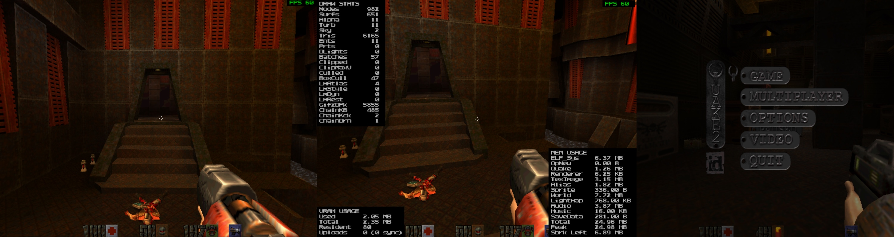

# Quake II port for the PlayStation 2



> **Tested on real hardware.** The game boots and plays on a PS2, loading its data from a USB drive
> or PlayStation HDD, as well as in the PCSX2 emulator. Both TV standards are supported, **PAL (50 Hz)
> and NTSC (60 Hz)**: auto-detected from the console, or forced with `ps2_video_mode` (also in
> the video options menu), so a PAL console can run at 60 Hz on a TV that takes it.

## Overview

This is an unofficial fan-made port, targeting the PlayStation 2 console, of the original
[Quake II source code released by id Software][link_id_repo].

The port relies solely on the free [PS2DEV SDK][link_ps2_dev] to provide rendering, input,
audio and system services for the Quake II engine — no official Sony SDK, no proprietary
libraries. This project's goal is a fully functional and playable single-player Quake II
on the PS2, built entirely with freely available tools.

The engine, game and server code under [src/client/](src/client/), [src/common/](src/common/),
[src/game/](src/game/) and [src/server/](src/server/) is id's original C, kept as close to
untouched as possible. Everything specific to the console lives in [src/ps2/](src/ps2/) and is
written in modern C++ (C++20, no exceptions, no RTTI, warnings-as-errors). The two halves meet
at a small number of well defined seams — `refexport_t`, `SNDDMA_*`, `IN_*`, `Sys_*`, `NET_*`
— where the original win32/linux backends plugged in.

### What works today

- **A complete rendered frame.** World BSP geometry with textures and lightmaps, brush model
  entities, MD2 alias models (monsters, items, the view weapon), sprites, the skybox,
  particles, beams, dynamic light flares, translucent surfaces (water/glass/lava), the
  fullscreen damage/powerup blend, and the whole 2D layer (console, HUD, menus, cinematics).
- **VU1-accelerated rendering.** Vertex transform, triangle clipping, backface culling and
  GS packet building all run on VU1 microprograms written in VCL, and so do MD2 keyframe
  interpolation, dynamic lighting, the turbulent water warp and particle billboards. The one
  EE-side clipper left, for the sky, uses VU0 macro mode for its vector math.
- **Coloured lightmaps**, including animated light styles and dynamic lights folded in at
  frame time.
- **Sound.** The stock portable Quake mixer painting into a ring buffer that is streamed to
  the SPU2 through the `audsrv` IOP driver, including cinematic audio.
- **Music.** The CD soundtrack, streamed from loose SPU2 ADPCM files in `baseq2/music/`
  in place of the disc's audio tracks - or straight from the ripped WAVs if they haven't
  been converted - with id's per-map tracks and looping rules.
- **Input.** DualShock gamepad (analog sticks + full button mapping + rumble) and an optional
  USB keyboard through `ps2kbd`, usable simultaneously.
- **Save games** on the memory card (MEMORY CARD slot 1, with a PS2 browser icon), or on the
  USB drive, hard disk or emulator host filesystem the game booted from, under the notice PS2
  games show while a save is written or read. A save made by one build loads in the next unless
  the saved structures changed, and every failure is explained in an on-screen message box.
- **Memory.** A `dlmalloc`-backed program-wide heap with per-subsystem tag accounting, and a
  GS VRAM texture heap with LRU eviction and defragmentation.
- **Compressed game data.** An optional zip pack, `pak0.pkz` (`make pkz`), that holds the same
  files as `pak0.pak` in 92 MB instead of 175, so a level load reads about half the bytes off a
  USB stick and takes 25-40% less time. It is inflated on the EE as it is read.
- Runs on both the **PCSX2 emulator** and **real hardware**, loading game data from
  `host:` for development, an APA/PFS PS2 HDD, or USB mass storage, with PAL or NTSC video.

---

## Getting started

### Prerequisites

1. **The ps2dev toolchain and PS2SDK.** Build/install from [ps2dev][link_ps2_dev]
   (`ps2toolchain` + `ps2sdk`). The build expects these on `PATH`:

   | Tool | Comes from | Typical location |
   | --- | --- | --- |
   | `mips64r5900el-ps2-elf-gcc` / `-g++` | ps2toolchain | `$PS2DEV/ee/bin` |
   | `openvcl` | openvcl | `$PS2DEV/bin` |
   | `dvp-as` | ps2toolchain (dvp) | `$PS2DEV/dvp/bin` |
   | `bin2c` | ps2sdk | `$PS2SDK/bin` |

   Note the toolchain prefix is `mips64r5900el-ps2-elf-*`, not the older `ee-gcc`.

   On macOS, ps2dev's `build-all.sh` also needs Homebrew's `pkgconf`, and GNU sed ahead of
   the system one, or its ps2sdk-ports step fails:
   `PATH="$(brew --prefix gnu-sed)/libexec/gnubin:$PATH" ./build-all.sh`. After updating the
   SDK, run `make clean`: make tracks neither the SDK's headers nor its libraries.

   `make` also builds the [host tools](#host-tools) with the machine's own C++20 compiler,
   through **CMake 3.24 or newer**, so `cmake` has to be on `PATH` as well.

   A `~/.zshenv` (or equivalent) along these lines is what the Makefile and the VSCode
   tasks expect:

   ```sh
   export PS2DEV=$HOME/ps2dev
   export PS2SDK=$PS2DEV/ps2sdk
   export PATH=$PS2DEV/bin:$PS2DEV/ee/bin:$PS2DEV/dvp/bin:$PS2SDK/bin:$PATH
   ```

   Both `PS2DEV` and `PS2SDK` can also be overridden on the `make` command line.

2. **PCSX2**, if you want to run it on the emulator, plus a PS2 BIOS image for it.
   The Makefile's `run` target defaults to `/Applications/PCSX2.app/Contents/MacOS/PCSX2`;
   override `PCSX2=` for other platforms/locations.

3. **The Quake II game data.** Not included here and not redistributable — copy it from
   your own retail install. Place it in a `baseq2/` directory at the root of
   the repository (it is `.gitignore`d):

   ```
   quake2-ps2/
     baseq2/
       pak0.pak
       pak0.pkz      (optional, made by `make pkz` - see below)
       players/      (optional, loose files)
       video/        (optional, .cin cinematics)
       music/        (optional, trackNN.adp or trackNN.wav soundtrack - see below)
       config.cfg
   ```

   A loose-file tree works as well as the `.pak`; [src/tools/host/unpak.cpp](src/tools/host/unpak.cpp)
   builds a small extractor for that.

   `make pkz` converts `pak0.pak` into `pak0.pkz`: a zip of the same files, most of them
   deflated, in 92 MB instead of 175. The game loads a `pakN.pkz` in place of the `pakN.pak`
   beside it, so a USB stick needs only the `.pkz`, and a level load reads about half the
   bytes. [How to run](#how-to-run) says which pack suits which drive, and
   [File system](#file-system) how it works.

   The soundtrack is optional too. Rip the CD's audio tracks 2-11 to 16-bit PCM WAVs named
   `baseq2/music/trackNN.wav` (NN = the CD track number; any case), then run `make music`
   to encode them into the `trackNN.adp` files the game streams - SPU2 ADPCM at 22050 Hz,
   about 1.5 MB a minute, ~41 MB for the whole soundtrack. Only the `.adp` files need to go
   onto a USB stick. Input must be at 22050 Hz or exactly twice that (a CD rip); convert
   anything else first, e.g. `afconvert -f WAVE -d LEI16@22050 -c 2 in.flac out.wav` on macOS.

   Skipping `make music` works too: for a track with no `.adp`, the game plays the
   `trackNN.wav` itself (16-bit PCM, mono or stereo). It is the heavier option on every
   count - a CD rip is 7x the bytes of its `.adp` (176 KB/s off the USB stick), holds 128 KB
   of RAM in read buffers instead of 16 KB while it plays, and costs more EE time to resample
   from 44.1 kHz - so it is a convenience, not the way to ship. 44.1 and 22.05 kHz play best;
   other rates go through a plain linear resampler.

### Building

Three dependencies come in as git submodules: [vclpp](https://github.com/glampert/vclpp), the
preprocessor the VU microprograms go through, at [src/tools/vclpp/](src/tools/vclpp/) (built
with its own Makefile, with a submodule of its own), [vu-checker](https://github.com/glampert/vu-checker),
the checks every VU build runs over the toolchain's output, at [src/tools/vu-checker/](src/tools/vu-checker/),
and [miniz](https://github.com/richgel999/miniz), the deflate codec the save games are compressed
with, at [src/tools/miniz/](src/tools/miniz/) (its sources are compiled straight into the game).
Clone with `--recursive`, or run
`git submodule update --init --recursive` in an existing clone.

```sh
make            # debug build -> build/debug/quake2.elf (+ host tools)
make release    # optimized   -> build/release/quake2.elf
make run        # build, then launch it in PCSX2
```

Header dependencies are tracked automatically (`-MMD`), so editing a header rebuilds only
the affected objects.

[CI](.github/workflows/ps2.yml) runs `make` and `make release` on Linux for every push and pull
request that changes more than the documentation, inside the ps2dev project's
[`ps2sdk` container image](https://github.com/ps2dev/ps2sdk/pkgs/container/ps2sdk), pinned to
one build of it. It checks that both configs compile and link, and keeps no ELF: releases are
packaged from local builds, as described below.

#### Debug and release

| | `make` (debug) | `make release` |
| --- | --- | --- |
| Optimization | `-O2` | `-O3` |
| Debug info | `-gdwarf-2 -gz` | none |
| `PS2_Assert` / `PS2_AssertMsg` | on | compiled out |
| `PS2_QUAKE_DEBUG` (tests, debug-only code) | in | compiled out |

Each config keeps its own object tree under `build/<config>/`, so switching back and forth
neither mixes objects built with different flags nor forces a full rebuild. `release` is
just a config selector, so it composes: `make release run` builds and launches the release
ELF. `BUILD=debug` / `BUILD=release` does the same thing from the command line.

Both configs **strip** the linked ELF, which is mostly about the debug build — DWARF
dominates its size, and stripping saves several MB of file size. Nothing is lost: the
PS2 loader only reads program headers, and the full symbols stay next to it in
`quake2_unstripped.elf` (feed that one to `addr2line` to resolve a crash address). Build
with `STRIP_ELF=0` to ship the unstripped ELF as `quake2.elf` instead.

#### Makefile targets

| Target | What it does |
| --- | --- |
| `make` / `make all` | Builds `build/debug/quake2.elf` and the host tools. |
| `make release` | The same, optimized, into `build/release/quake2.elf`. |
| `make run` | Builds, symlinks `build/<config>/baseq2` → `baseq2/`, and launches PCSX2 with the ELF. |
| `make tools` | Builds the host-side command line tools into `build/tools/` (see below). |
| `make music` | Encodes every `baseq2/music/trackNN.wav` into the `trackNN.adp` file beside it, skipping up-to-date ones. |
| `make pkz` | Converts every `baseq2/pakN.pak` into the compressed `pakN.pkz` beside it, skipping up-to-date ones. |
| `make compiledb` | Regenerates `compile_commands.json` from the Makefile, for IntelliSense/clangd. Run after adding or removing source files. |
| `make clean` | Removes all build artifacts, both configs. |
| `make clean_vu` | Removes only the assembled VU microprograms (`build/vu/`). |

To cut a release, [make_github_release.sh](src/tools/scripts/make_github_release.sh)
`[-f] [-u] [version]` runs `make clean`, `make` and `make release`, then packages each
config's `quake2.elf` with `LICENSE`, [RELEASE_NOTES.txt](misc/RELEASE_NOTES.txt) (its
`@VERSION@` and `@COMMIT@` filled in, so it points to the exact source), an empty `baseq2/`
tree and the committed `config.cfg` into `github_rel_<version>/` (one zip per config). `-u`
adds `quake2_unstripped.elf`. `version` defaults to `VERSION` in `src/common/q_common.h`.

The host tools and the assembled VU microprograms are config-independent (no EE compiler
flag reaches either), so they are built once and shared, outside `build/<config>/`.

Useful variable overrides: `BUILD=`, `STRIP_ELF=`, `PS2DEV=`, `PS2SDK=`, `PCSX2=`,
`HOST_CXX=`, and `-DPS2_FS_BASE_PATH=\"host:.\"` in `COMMON_DEFS` to pin the game data path
and skip autodetection.

#### Host tools

Built from [src/tools/host/](src/tools/host/) with the *host* C++ compiler, not the EE
toolchain (`symbolize` is a Python 3 script from [src/tools/scripts/](src/tools/scripts/)
and is simply copied into place):

- `build/tools/symbolize` — turns a stack trace dump printed by the running game into
  function names, files and line numbers. See [Reading a stack trace](#reading-a-stack-trace)
  below.
- `build/tools/unpak` — extracts a Quake II `.pak` archive into a normal directory.
- `build/tools/pakzip` — converts a `.pak` into a compressed `.pkz` pack
  (`pakzip [--level N] [--block-kb N] [--min-saving P] in.pak out.pkz`). It reads its output
  back and checks every file, and every restart point, against the pak before replacing
  `out.pkz`. Built with the [miniz](src/tools/miniz) submodule; the format is in
  [pkz_format.h](src/ps2/fs/pkz_format.h), which the game reads it with too.
- `build/tools/musenc` — encodes a 16-bit PCM `.wav` into a streamed music file (`.adp`,
  SPU2 ADPCM), and `musenc -d` decodes one back to `.wav` for listening. It shares the
  decoder with the game ([spu_adpcm.h](src/ps2/audio/spu_adpcm.h)), so the SNR it reports is
  of exactly what the console plays.
- `build/tools/imgdump` — dumps `.pcx` images into C++ byte arrays
  (`imgdump [--format pal|rgba32|rgb16] [--palette colormap.pcx] [--out dir] image.pcx...`):
  the 8-bit palette indices as they are by default, or expanded to RGBA32 or RGB16. `--palette`
  also writes that palette out as the global one. It made the built-in console font, console
  background, HUD backtile, id logo and global palette under [src/ps2/builtin/](src/ps2/builtin/),
  which are compiled into the ELF so the executable can show its boot splash and print errors
  before any game data is found.

The C++ tools are a CMake project, [CMakeLists.txt](src/tools/host/CMakeLists.txt). `make`
configures it once into `build/tools/cmake/`, then runs its build every time, which does
nothing while the tools are up to date. They are built optimized (`Release`) and held to the
game's strict warning set as errors (`/W4` under MSVC). They build on Windows too, with MSVC.
From the repository root:

```sh
cmake -S src/tools/host -B build/tools
cmake --build build/tools --config Release
```

That leaves the `.exe` files in `build/tools/Release/`. They link the C/C++ runtime statically,
so they run without the Visual C++ Redistributable. [CI](.github/workflows/tools.yml)
builds the tools on Linux (GCC), macOS (Apple clang) and Windows (MSVC) whenever they, or the
headers they share with the game, change. Each run keeps the Windows executables as an artifact,
`host-tools-windows-x64`, on its page under the repository's Actions tab, for 90 days. Downloading
it needs a GitHub sign-in. The workflow can also be started by hand from there.

## How to run

The game looks for `baseq2/` in three places and uses the first one that has it: **the
emulator's host filesystem, then a PS2 HDD, then a USB drive**. Each wants a different setup:

| | Emulator (`host:`) | HDD | USB |
| --- | --- | --- | --- |
| What it reads | the repo's `baseq2/`, through PCSX2 | an APA/PFS partition on the drive in a fat PS2's expansion bay | a FAT32/exFAT drive on the PS2's USB 1.1 port |
| Best pack | `pak0.pak` | either; `pak0.pkz` is smaller | `pak0.pkz` |
| Best for | development and debugging | playing on a console | a console without an HDD |
| A level load | a few seconds | about 15 s | about 30 s |

**Which pack.** `make pkz` turns `pak0.pak` into `pak0.pkz`, the same files compressed into
92 MB instead of 175 (see [File system](#file-system)). When both are in `baseq2/`, the game
loads the `.pkz` and ignores the `.pak`, so a drive needs only one of them. The `.pkz` is
inflated as it is read, which pays off in proportion to how slow the drive is. Loading base2,
with release builds on one PAL console:

| | `pak0.pak` | `pak0.pkz` |
| --- | --- | --- |
| HDD (a Hitachi drive on a SATA adapter) | 15.8 s | 14.8 s |
| USB stick, FAT32 with 32 KB clusters | 40.4 s | 29.9 s |
| USB stick, FAT32 with 8 KB clusters¹ | 58.6 s | 36.5 s |

¹ With fileXio's stock 16 KB read buffer. The game now asks for 64 KB, which makes little
difference on 8 KB clusters: the FAT driver never reads past a cluster in one go.

In PCSX2 the `.pkz` is the slower one (a debug base1 load took 6.1 s against 4.2 s), since
`host:` reads cost almost nothing and inflating doesn't. Leave it out of the repo's `baseq2/`
for emulator work, or move it aside.

### In PCSX2 (host filesystem)

`make run` builds the debug ELF and launches it (`PCSX2 -batch -elf build/debug/quake2.elf`),
or `make release run` the release one. PCSX2 itself needs a couple of settings that are
**off by default**. Edit `PCSX2.ini` **while PCSX2 is closed** — it rewrites the file on exit
and will clobber your changes. On macOS it lives at
`~/Library/Application Support/PCSX2/inis/PCSX2.ini`.

#### 1. Enable the host filesystem (`host:`)

```ini
[EmuCore]
HostFs = true
```

PCSX2 maps `host:` to the directory the ELF was loaded from — that is `build/debug/` (or
`build/release/`), and the `run` target symlinks a `baseq2` there back to the repo's
`baseq2/`. Without `HostFs`, boot falls through to HDD and USB; if neither has game data,
the game halts with *"No game data found"*. The equivalent UI toggle
(Settings → Advanced → Enable Host Filesystem) is hidden unless advanced settings are shown.

#### 2. Enable the IOP console, to see the game's stdout

```ini
[Logging]
EnableIOPConsole = true
EnableFileLogging = true
```

The game's `Com_Printf` output goes to stdout, and ps2sdk routes stdout through the IOP fio
path — so the EE console setting alone shows nothing. With both flags on, the log appears in
the PCSX2 log window and in `logs/emulog.txt`, which can be followed live. All engine output
is prefixed with `[Q2]` so it can be separated from the emulator's own chatter:

```sh
tail -f ~/Library/Application\ Support/PCSX2/logs/emulog.txt | grep '\[Q2\]'
```

#### 3. Optional: a virtual USB keyboard

```ini
[USB1]
Type = hidkbd
```

This attaches a HID keyboard that passes host keystrokes straight through — no per-key
bindings to set up. A debug build brings the keyboard driver up at boot, since `in_keyboard`
defaults to 1 there; a release build defaults it to 0, so set it to 1 to use the keyboard
with one. The cvar is archived, so a value in `config.cfg` holds in either build. Two quirks
worth knowing:

- The emulated device reports itself as a JIS keyboard, so at boot it logs a batch of
  harmless `Missing host mapping for QKey '<name>'` warnings for JIS-only keys.
- It sends USB HID usage `0x34` (the *apostrophe* usage) for the host's `` ` ``/`~` key,
  and never sends `0x35` (grave). The port maps `0x34` to `` ` `` so the console toggle
  works under the emulator; on real hardware, hand it back with `in_keyboardmap 0x34 '`.

### On a console

Copy `quake2.elf` and `baseq2/` side by side into a folder on the HDD or the USB drive, then
load the ELF with your launcher of choice (uLaunchELF, wLaunchELF, ...). A release zip's
`q2ps2_<config>_<version>/` folder already has this layout, so it can be copied over as it is:

```
mass:/q2ps2_release_3.20/
  quake2.elf
  baseq2/
```

Play the release ELF; the debug one is slower and checks more. Storage, keyboard and sound
drivers are all embedded in the ELF, so nothing else needs to be installed on the drive.

At boot the id logo comes up on black at once, and stays until the game draws its first frame.
`host:` fails instantly on a console. Boot then takes the IOP as the launcher left it: each
driver the game needs (iomanX/fileXio, the HDD's and USB's, and later the pad, memory card,
sound and keyboard drivers) is reused when the launcher left one doing that job running, and
loaded otherwise. So a USB drive the launcher had already mounted is read straight away. The
IOP is reset first, as every boot used to, only when something running can't work alongside
the game's drivers; and the boot falls back to that reset when a driver won't start, when no
game data turns up through the launcher's drivers, or when too little IOP memory is left.
`-DPS2_QUAKE_ALWAYS_RESET_IOP=1` resets every time. **An ELF launched from USB (`mass:`) looks
for its data on USB only** and leaves the HDD alone: on a console with its HDD attached,
searching the HDD's partitions first took 25 s. Launched from anywhere else, it looks on the
HDD and, if no HDD has the data, on USB, so there a copy on the HDD wins. On the HDD, mounting
the game's partition takes seconds (4 s for the 7.3 GB one tested): its name is found by walking
the APA partition chain from the start of the disk, one header read per partition ahead of it,
and the mount then reads the partition's whole free-space bitmap, which grows with its size. The `IOP boot:` lines
in the console and in `quake2.log` say what the launcher left running, what the boot reused,
loaded or reset, and when each step finished. Once the
drive is found, boot gives fileXio a 64 KB read buffer instead of its stock 16 KB (see
[System and memory](#system-and-memory)).

When no device has the data, the error screen shows the ELF path, the folders searched, the
HDD status and the mounted USB volumes. `USB volumes mounted: none` means USB did not come up
or the drive has no FAT partition.

**Video mode.** By default the game runs in the console's own standard: 50 Hz on a PAL console,
60 Hz on an NTSC one. Set `ps2_video_mode` to `ntsc` or `pal` (or pick "video mode" in the
video options) to force one after a restart. A PAL console can drive NTSC if the TV accepts
60 Hz; over composite a PAL-only set may lose the colour, while RGB SCART and component are
fine. `ps2_fb_height` 0, the default, gives each standard its full height: 448 lines for NTSC,
512 for PAL. A set that cuts an edge off can have the picture moved with the video options'
"screen x" and "screen y" rows (`ps2_screen_x`, `ps2_screen_y`: pixels and rows either way), which
draw a white line along the picture's edge while either is under the cursor.

#### From the HDD (fastest)

This needs a fat PS2 with the network adapter and a drive in its expansion bay (IDE, or SATA
through an adapter), formatted for the PS2 (APA, e.g. with uLaunchELF's HDD Manager). Make a
PFS partition such as `+Q2PS2` and copy the folder into it. With every video and the
soundtrack, the game takes about 290 MiB with only `pak0.pkz` and about 375 MiB with only
`pak0.pak`, so a 512 MiB partition holds either. The HDD loads a level twice as fast as the
best USB setup, and both packs load about as fast there: pick the `.pkz` to save the space.

Boot loads the embedded DEV9/ATA/APA/PFS drivers. The partition and folder come from the ELF
path the launcher passes (`argv[0]`), including `hdd0:+Q2PS2:pfs:/dir/quake2.elf` and
`hdd0:/+Q2PS2/dir/quake2.elf`. The launch partition is checked first, its folder before its
root. Other main PFS partitions are then searched, all matching folders before roots. This
also handles a bare `pfsN:` launch path, which doesn't say which partition it was. The chosen partition stays mounted at `pfs0:` for all of the game's file I/O. A
console without an HDD, or whose HDD drivers fail, goes on to USB.

#### From USB

Any USB drive works, but the PS2's ports are USB 1.1: at best about 0.9 MB/s, so a faster
stick doesn't help. What does help is fewer bytes and fewer USB commands:

- **Use `pak0.pkz`.** It reads about half the bytes, and loads 25-40% faster than the `.pak`.
- **Format the drive as FAT32 with 32 KB clusters** (allocation units) **or larger.** The FAT
  driver reads at most one cluster per USB command, and each command costs about 5 ms on top
  of its transfer. macOS picks 8 KB clusters for a 16 GB stick, and its Disk Utility can't
  change that; `sudo newfs_msdos -F 32 -c 64 -v NAME /dev/rdiskNsM` can (`-c 64` = 64 sectors,
  32 KB; it erases the volume, so check the device with `diskutil list` first). On Windows,
  pick the allocation unit size in the Format dialog. exFAT works too, if your launcher can
  read it.

Boot starts the embedded BDM/USB stack and waits up to 10 seconds for the drive. Every FAT
volume is probed (`mass0:` to `mass9:`, one per partition, in mount order; two drives can be
attached), the launch folder on all of them before their roots, so the data needn't be on
the first partition or drive. The folder can be up to 50 characters long, which keeps the
game's paths within their 128-byte limit. A `baseq2/` at a volume's root is the fallback.

### Testing HDD or USB storage in PCSX2

Set `HostFs = false` to exercise the console storage paths. The HDD settings are:

```ini
[DEV9/Hdd]
HddEnable = true
HddFile = /absolute/path/to/quake2-hdd.raw
```

For USB, use a writable raw MBR/FAT32 disk image rather than an optical-disc ISO:

```ini
[USB2]
Type = Msd
Msd_subtype = 0
Msd_ImagePathMsd = /absolute/path/to/quake2-usb.img
```

PCSX2 doesn't emulate either drive's speed, so load times there say nothing about a console.
Boot prints the device it selected, including the APA partition name for HDD; as on a
console, a matching HDD installation wins over USB, so disable the HDD to test USB.

To prepare a new HDD and transfer a single-build USB package:

1. In **PCSX2 → Settings → Network & HDD**, enable the HDD, choose a new `.raw` image,
   and click **Create Image**. Keep the USB image attached for the transfer.
2. Boot uLaunchELF and open **FileBrowser → MISC → HddManager**. For the new, blank
   image, use **R1 → Format** to create the PS2's APA partition layout.
3. Use **R1 → Create** to make a PFS partition named **`+Q2PS2`**. **512 MiB** holds the
   whole game, music and videos included, with either pack.
4. In FileBrowser, open **`mass:/`**, select **`quake2.elf`** and **`baseq2/`** with
   **Square**, then choose **R1 → Copy**.
5. Navigate to **`hdd0:/+Q2PS2/`** and choose **R1 → Paste**. Open the copied
   **`quake2.elf`** to launch the game from HDD.

For repeated tests, [make_usb_image.py](src/tools/scripts/make_usb_image.py) creates a
writable raw MBR/FAT32 image on macOS using `hdiutil`:

```sh
make
make release
python3 src/tools/scripts/make_usb_image.py
```

The script packages the existing builds; it does not compile them. Its default output is
`build/quake2-usb.img`, with volume name `Q2PS2`, sized automatically with free space and a
minimum of 256 MiB:

```
mass:/
  quake2_debug.elf
  quake2_release.elf
  baseq2/
```

`baseq2/` copies the working directory, including the current `config.cfg`, players, saves
and videos. Music includes only `.adp` tracks; `.wav` files are omitted. Of a `pakN.pak` and
`pakN.pkz` pair only the `.pkz` is copied, since the game loads it in the pak's place;
`--uncompressed-paks` copies the `.pak` instead, for comparing the two. The decompressed
`baseq2/pak0/` directory is omitted when `baseq2/pak0.pak` or `pak0.pkz` exists. Only the
stripped ELFs are included, renamed by configuration and placed beside the data. For HDD,
copy `quake2_debug.elf`, `quake2_release.elf` and `baseq2/` together into the PFS partition.
Launch either ELF in uLaunchELF.

Use `--output /path/to/test.img` to choose another destination, `--size-mib 1024` to choose
a fixed size, and `--force` to replace an existing image after a successful build. Close
PCSX2 before replacing an attached image, then point USB2's `Msd_ImagePathMsd` at the output.

---

## Editor setup (VSCode)

The repo ships `.vscode/tasks.json` (Shift+Cmd+B → build) and `.vscode/launch.json`
(F5 → `make run`). Those inherit the toolchain environment from your shell profile, so they
need no configuration.

IntelliSense does need one edit: it is served by the C/C++ extension, not by a shell, so it
cannot read your `~/.zshenv`. `.vscode/c_cpp_properties.json` declares the SDK location
itself, and `PS2DEV` is the single literal path in the whole file — point it at your install:

```jsonc
{
  "configurations": [
    // ...
  ],
  "env": {
    "PS2DEV": "/Users/you/ps2dev", // <-- change this
    "PS2SDK": "${PS2DEV}/ps2sdk"
  }
}
```

`compile_commands.json` is per-machine and `.gitignore`d; generate it with `make compiledb`.
It carries the exact per-file flags (language standard, `-isystem` paths, warning set), so
both the C/C++ extension and clangd see what the compiler really sees. Regenerate it whenever
source files are added or removed.

---

## Source layout

```
src/
  client/ common/ game/ server/   id's original Quake II C code
  null/                           id's null driver stubs - none are built any more
  tools/
    host/                         host-side C++ command line tools (imgdump, unpak, bspinfo, musenc, pakzip)
    scripts/                      Python helpers (symbolize, compile_commands.json generator, gen_save_tables - the save games' function/animation name tables) and make_github_release.sh
      frame_log/                  frame-log capture analysis (summarize, compare, frame budget)
    vclpp/                        VCL preprocessor for the VU microprograms (git submodule)
    vu-checker/                   check_vu_code.py, the openvcl/dvp-as output checks run by every VU build (git submodule)
    miniz/                        deflate codec for the save games and the compressed packs (git submodule)
    vscode_extensions/            VCL/VU assembly syntax highlighting for VSCode
  ps2/                            the PS2 backend - all new C++ code
    system/                       main() entry point, Sys_* seam, IOP boot, dlmalloc heap
    renderer/                     GS front-end, VRAM heap, textures, models, VU1 path
      vu1progs/                   VU1 microprograms (.vcl)
    audio/                        SNDDMA_* seam, audsrv device, mix ring, CD music streaming
    input/                        IN_* seam, DualShock pad and rumble, USB keyboard
    math/                         vector/matrix math for the renderer
    net/                          NET_* seam (loopback only)
    save/                         Sys_Save* seam: save working set, slot archives, memory card, boot drive, the save notice
    fs/                           compressed game packs (pakN.pkz) for the engine's file system
    builtin/                      images baked into the ELF (font, palette, HUD tiles, id logo)
    debug/                        simple on-screen printing for fatal errors, stack trace, HW exception handling
    tests/                        standalone bring-up scenes and tests (test cube, cinematics, map cycle, save games, perf run)
```

Every file carries a header comment explaining what it does and *why* it does it that way.
[src/ps2/common.h](src/ps2/common.h) is the single seam between the C++ backend and the C
engine — backend sources usually include it rather than reaching into engine headers directly.

---

## Architecture

### Rendering

The renderer implements `refexport_t` in [ps2/renderer/ref.cpp](src/ps2/renderer/ref.cpp) —
the same interface `ref_gl` and `ref_soft` implemented, but we link statically rather than
having a DLL as the original Quake 2 did.

**Video mode and VRAM budget.** 640x448 on NTSC and 640x512 on PAL, double-buffered using both
GS drawing contexts. `ps2_video_mode` ("video mode" in the video options, after a restart)
picks the standard: `auto` takes the console's own (from its BIOS ROM name), and `ntsc` or
`pal` force one, so a PAL console can run at 60 Hz on a TV that takes it
([video_mode.h](src/ps2/system/video_mode.h), which the fatal-error screen shares).
`ps2_fb_height` 0 follows the standard's full height; 512 lines leave 240 KB less VRAM for
textures than 448. `ps2_screen_x` and `ps2_screen_y` move the picture on the TV through the GS
DISPLAY register's origin ([video_mode.h](src/ps2/system/video_mode.h)): the GS comes up with
them, a change goes out with the next present, in the same blanking interval as the frame's
DISPFB, and the fatal-error screen puts its text in the same place. The framebuffer format is chosen by `ps2_fb_16bit` (default on): 16-bit
buffers cost 560 KB each instead of 1120 KB, which is where most of the texture heap's
headroom comes from, and halve the GS's colour write and blend-read bandwidth — at the cost
of 5:5:5 colour, which `ps2_fb_dither` can smooth over. Depth is 16-bit either way (the GS
requires colour and depth to share a page layout). What is left after the two framebuffers,
the z-buffer and CLUTs — ~1.27 MB in the 16-bit configuration — becomes the
streamed texture heap.

**Boot splash** ([splash_screen.h](src/ps2/renderer/splash_screen.h)). First thing in `main()`,
before any IOP driver comes up, the GS is set up the way `gs::Init` sets it up with the default
video settings, and the id logo (`pics/m_main_logo.pcx`, built into the ELF) is drawn at four
times its size on black, brightened by `kColorIntensity` (splash_screen.cpp), into what becomes
the first framebuffer. So the logo stays up through
the boot and `gs::Init`, until the game presents its first frame. When `ps2_video_mode`,
`ps2_fb_height` or `ps2_fb_16bit` lay that framebuffer out differently, `gs::Init` starts it
black instead, since it would read the logo's texels the wrong way. A splash that can't be drawn
is skipped.

**Frame structure.** `BeginFrame()` clears colour and depth; 2D and 3D then draw in any
order; `EndFrame()` flushes, waits for vsync and flips. The vsync wait sleeps on the vblank
interrupt (a semaphore signalled from an `INTC_VBLANK_S` handler), so the 8-11 ms a frame leaves
before its field ends go to the other threads; `ps2_vsync_spin 1` brings the old status-register
spin back. 2D primitives accumulate into a
deferred batch with an always-pass z-test so they land on top, and that batch is flushed
automatically at each 2D→3D boundary and again at end of frame. Flushing at the boundary is
not just about layering: it consumes the deferred draws before a later 3D texture upload can
evict the VRAM they sample.

**VRAM texture heap** ([vram.h](src/ps2/renderer/vram.h)). Textures stream in on first bind;
while resident, binding one is just a `TEX0`/`TEX1` register write — no DMA, no pipeline
flush. When the heap fills, the least-recently-bound textures are evicted, never ones bound
in the current frame (their draws may still be in flight). Allocation failure is recoverable
rather than fatal: drain the GS, unpin, retry, defragment, retry. The heap is also
defragmented on level change.

**Textures and CLUTs** ([texture.h](src/ps2/renderer/texture.h)). Most world and model
textures stay 8-bit (`PSMT8`) and sample Quake's shared 256-entry palette through a CLUT,
which keeps them a quarter the size of RGBA. Walls, skins and sprites, which a light
multiplies back down, sample a second copy brightened by `ps2_intensity`, as `ref_gl`'s
`intensity` did. A third CLUT is an alpha ramp used by images that carry only a coverage
signal — the particles — where the index *is* the alpha and the colour comes from the
primitive, and a fourth is the same for the lightmap atlases' light.

**Brightness and contrast** ([gamma.h](src/ps2/renderer/gamma.h)). The video menu's
"brightness" and "contrast" sliders, `vid_gamma` and `vid_contrast`, make the picture
`pow(colour * contrast, gamma)`. The GS has no stage that could apply that to the finished
frame, so it goes into the palette, as `ref_soft`'s gamma did: into the two palette CLUTs,
and into the colours the EE takes from the palette itself (particles, beams, fills, the
cinematics' palette). The light takes the curve apart from the texture, since
`pow(t * l, g)` is `pow(t, g) * pow(l, g)`: a wall's luxel in the lightmaps' light ramp CLUT,
a model's shade light per model. The contrast is in the palette alone. A change rebuilds the
tables and uploads the CLUTs again at the next frame, after finishing the one left drawing.
At 1 and 1 the tables are what they were without them: a scripted screenshot of the demo is
pixel-identical to one from before the sliders.

**2D scrap atlases** ([scrap_atlas.h](src/ps2/renderer/scrap_atlas.h)). A texture occupies
every GS page its pixels touch, so a 24x24 HUD icon would otherwise cost a full 8 KB page.
The small pics are packed into shared 256x256 atlases instead — baseq2's 89 such pics drop
from 712 KB of VRAM to a fraction of that, and a HUD frame binds one texture instead of
fifteen.

**Lightmaps** ([lightmap.h](src/ps2/renderer/lightmap.h)). The BSP's baked light samples are
packed into 256x256 atlases at load time and baked into a second UV set on the vertices.
Surfaces whose lighting moved (animated light styles, dynamic lights) are rebuilt at frame
time and chained per atlas. Colour is the interesting part: the GS blend unit computes
`(A - B) * C + D` where `C` is a scalar alpha and never a second colour, so
`diffuse x coloured-lightmap` is not expressible as a single blend. So a luxel is split — the
atlases the hardware samples are alpha-only and carry the luxel's *intensity*, multiplied in
per pixel, while its chroma rides in an EE-RAM mirror sampled per vertex and folded into the
vertex colour the wall texture is modulated by. Intensity times chroma reconstructs the
luxel: full resolution in the term that varies per pixel, vertex resolution in the one that
barely varies at all.

**VU1 path** ([vu1.h](src/ps2/renderer/vu1.h), [vu1progs/](src/ps2/renderer/vu1progs/)).
Triangle batches are submitted as VIF1 source chains: frame constants (MVP, GS screen
mapping, clip scale) and a per-draw block (the dynamic lights, or an MD2 draw's lerp
constants) unpacked to fixed VU addresses, then chunks of up to 90 vertices (60 for MD2)
unpacked into a double buffer with `MSCAL` to run the microprogram. It transforms, clips,
builds the GS packet in one of two output windows and `XGKICK`s each window over PATH1 as it
fills, alternating between them. `XTOP` flips on every `MSCAL`, so the VIF unpacks the next
chunk while VU1 still works on the current one. There are two microprograms, written in VCL:

- `textured_triangles.vcl` — every triangle but the sky's: gouraud-shaded textured triangle
  lists, with the batch header choosing the per-vertex work. A vertex is either a plain
  `DrawVertex` or two byte-quantized MD2 keyframes lerped on the VU (with a back-face cull);
  its colour arrives packed or is computed on the VU, from four dynamic lights or from the
  model's shade; and turbulent surfaces warp their texture coordinates there too.
- `particles.vcl` — camera-facing billboards expanded to GS sprites: the soft round sprite
  through the alpha ramp, or with `r_particles 2` the classic flat squares of `ref_gl`'s
  `GL_POINTS`, the same sprite untextured.

**Frame chain** ([cmd_buffer.h](src/ps2/renderer/cmd_buffer.h)). Everything a frame sends — the
clear, every VU1 batch, the 2D overlay — is one DMA source chain built into one of two 768 KB
halves. The halves alternate per frame and live in the world loader's lump scratch, which is
dead during gameplay. With `ps2_gs_latency` on, the GS draws a frame while the EE runs the
next one's game work. Within a frame, the world pass (walls, lightmaps, sky) is kicked as soon
as it's built, so the GS draws it while the EE builds the models, particles, translucent
surfaces and 2D; on a console that took NTSC from 56.7 to 59.9 fps over the perf demos. A frame
that outgrows its half kicks what it has built and carries on in the other half, which that
kick has already waited out, so the GS draws the first part while the EE builds the rest. At 768 KB the perf demos never overflow; their heaviest frames reach
about 660 KB.

Each batch's A+D block programs `TEST`, `ALPHA` and `ZBUF` alongside `TEX0`/`TEX1`, so a
batch draws with the right z-test, blend equation and depth-write mask regardless of what
the surrounding 2D packets left behind.

**Clipping** ([vu_clip.i](src/ps2/renderer/vu1progs/vu_clip.i)). The microprogram clips
in clip space, Sutherland-Hodgman against the near plane and the four guard-band sides, and
fans the survivors out as triangles. The guard band is as wide as the GS 12.4 window
coordinates allow, so only the roughly 2% of triangles that leave it are cut; the GS scissor
does the on-screen trim. The far plane is judged but not cut, since it was never once
straddled across the perf demos. The sky is the one thing still cut on the EE
([clip.h](src/ps2/renderer/clip.h)): its faces are single quads spanning ninety degrees.

The VU toolchain fails silently in several ways that only show up on screen, so every VU
build runs the six checks in [check_vu_code.py](src/tools/vu-checker/check_vu_code.py) over its output: register allocation (by reaching
definitions), clip-flag and Q latency across branches, loop-counter and cross-loop register
reuse, immediate truncation, and branch reach.

**Frame pass order** ([view.cpp](src/ps2/renderer/view.cpp)), following
`ref_gl`'s `R_RenderView`: PVS + frustum culled world surfaces and the skybox, opaque
entities, translucent entities, dynamic light flares, particles, deferred translucent world
and brush surfaces, then the fullscreen polyblend.

### Sound

The mixing is entirely id's portable code — `client/snd_dma.c`, `snd_mem.c`, `snd_mix.c` are
in the build unchanged. The backend ([ps2/audio/](src/ps2/audio/)) only implements the five
`SNDDMA_*` entry points, exactly as `win32/snd_win.c` did:

- [`AudsrvDevice`](src/ps2/audio/audsrv_device.h) owns the streaming session over `audsrv.irx`
  (loaded with `libsd.irx`, both embedded in the ELF, by
  [iop_boot.cpp](src/ps2/system/iop_boot.cpp), like every IOP module), exposing audsrv's queue
  as "how many bytes fit right now" and "take these". The SPU2 is only reachable from the
  IOP — there is no EE-side mapping of its registers — so every mixed byte crosses SIF.
  Output is 16-bit stereo at 22050 Hz by default (`s_khz`; 11025 and 44100 also work),
  chosen because it matches most of the game's WAVs *and* the audio in the `.cin` videos,
  which avoids a `snd_restart` whenever a cinematic plays.
- [`MixRing`](src/ps2/audio/mix_ring.h) is the 64 KB buffer the mixer paints into and the
  bookkeeping around it. The play position reported back to the engine is how far we have
  *submitted*, not where the SPU2 actually is — the same trick the waveOut backend used.
  Since submission is paced by the device's free space, that cursor advances at exactly the
  playback rate and is monotonic by construction, which is what `GetSoundtime()` needs, and
  it means a stall long enough to drain the queue (a level load) recovers on its own with no
  resync logic.
- [sound_hold.h](src/ps2/audio/sound_hold.h) keeps those stalls silent. audsrv's IOP thread
  plays its ~106 ms ring whether or not anything new has arrived, so a frame blocked on the
  memory card, or a level load off USB, used to loop the ring's last tenth of a second until
  it came back: the soundtrack's stutter on saves, config writes and level changes. A hold
  plays out what is queued, rewrites the ring with silence and stops audsrv. While it lasts
  nothing is submitted, so the mixer and the music wait exactly where they were, and pick up
  from that sample after the release. The save notice holds it for as long as it is up, while a
  save device is read or written (saving, loading, listing the slots, config.cfg), once it has
  faded the music out; and so does the loading plaque from the moment it goes up, so a level's
  music starts as the plaque comes down. A level change brings the plaque up before it
  writes the level it leaves.

Audio bring-up failure is not fatal: a missing IOP driver just costs sound. `ps2_disable_sound 1`
turns it off deliberately.

**CD music.** Quake II plays its soundtrack from the disc's audio tracks, and this port has
no CDVD path, so [cd_audio.cpp](src/ps2/audio/cd_audio.cpp) implements the `CDAudio_*`
module over loose `baseq2/music/trackNN.adp` files instead. They are SPU2 ADPCM - the PS2's
native sample format, 3.5x smaller than 16-bit PCM - chunk-interleaved so the same files
could later be streamed straight into SPU2 voices. A track with no `.adp` falls back to its
`trackNN.wav` (16-bit PCM), so the music plays even if `make music` was never run.
[`MusicStream`](src/ps2/audio/music_stream.h) keeps just two read buffers in flight - 8 KB
each for ADPCM (~650 ms at 22050 Hz), up to 64 KB each for a WAV (~740 ms of a CD rip) - and
decodes on demand. The buffers come from the heap when a track starts and go back when it
stops, so music never holds memory across a level load, and a track that can't get them
stays silent with a warning instead of halting. The file reads are issued from a reader
thread at the main thread's priority, since a blocking read off a USB stick could otherwise
cost a frame. The decoded music is fed into the mixer's raw-sample channel (the one
cinematics use), so it reaches the SPU2 inside the existing audsrv stream at no extra SIF
bandwidth; a track at twice the mixer's rate (a 44.1 kHz WAV) goes through a 23-tap
half-band decimator ([half_band.h](src/ps2/audio/half_band.h)) on the way in. In PCSX2 it
costs about 0.14 ms of EE time per frame for an `.adp` track and 0.27 ms for a 44.1 kHz WAV.
Behaviour follows id's `cd_win.c`: a map's track loops `cd_loopcount` times, then the ambient
`cd_looptrack` loops for good.

### Input

[ps2/input/](src/ps2/input/) implements the `IN_*` seam over libpad and, optionally, the
`ps2kbd` driver. Both devices can be used at the same time.

**Gamepad.** [`GamePad`](src/ps2/input/pad.h) owns the connection state machine (connect →
request analog mode → map the vibration motors → ready) and per-frame polling, exposing the
button mask and sticks normalised to [-1, +1], and runs the two motors. [input.cpp](src/ps2/input/input.cpp) maps that onto the engine: the
right stick rotates the camera and the left stick moves the player, with the same
sensitivity/threshold cvars (`joy_yawsensitivity` and friends) the original win32 joystick
code used — negate a sensitivity to invert that axis. The thresholds are per-axis dead zones
of 0.25 of full deflection, not win32's 0.15: a worn DualShock 2 can rest further off centre
than that, which turned the camera with the stick released. They are archived, so a value
tuned to one pad persists. The travel past a dead zone is rescaled to the full range, so the
response ramps up from zero at its edge instead of jumping to the threshold value.

The Options menu's mouse rows act on the right stick, as there is no mouse. "camera rotation
speed" is id's `sensitivity` (1 to 11), which scales the stick's turning and looking as a
multiple of its default, 3. "invert look Y axis" makes `m_pitch` negative, which flips the
stick's up and down, as win32's joystick code did with the mouse inverted. "gamepad movement"
(`in_joystick`) turns both sticks off. The sticks always look, so the page has no free look,
lookspring or lookstrafe rows: those only changed mouse look, and nothing reads them here.

Buttons send **one of two keys depending on where input focus is**, so menus and the console
stay navigable without stealing gameplay binds. The gameplay keys are ordinary rebindable
`JOY`/`AUX` keys, given default binds at startup only if the user's config has not bound
them already:

| Button | Menu / console | In game (default bind) |
| --- | --- | --- |
| D-pad up / down | Up / Down | `invuse` / `inven` |
| D-pad left / right | Left / Right | `invprev` / `invnext` |
| Cross | Enter | `+moveup` (jump) |
| Circle | Escape | `+movedown` (crouch) |
| Square | Enter | `+use` |
| Triangle | Backspace (clears a bind in the controls menu) | `cmd help` |
| L1 / R1 | (same key as in game) | `weapnext` / `weapprev` |
| L2 / R2 | PgUp / PgDn | `+speed` / `+attack` |
| L3 / R3 | (same key as in game) | unbound / `centerview` |
| Start | Escape | Escape (menu toggle) |
| Select | `` ` `` | `` ` `` (console toggle) |

The Options menu's "customize controls" page is about these buttons: each action shows the
button bound to it, by name ("R2", "d-pad up", "triangle"), cross on a row then a button
rebinds it, and triangle clears it. While the page waits for a button, every button sends its
in-game key, so the bind lands where the button fires in play; start cancels. A keyboard's
binds are neither shown nor cleared there, since the keyboard uses `default.cfg`'s PC layout
as it is. The mouse look and keyboard look rows are gone, as nothing reads them here.

**Rumble.** [rumble.cpp](src/ps2/input/rumble.cpp) plays force feedback on the pad's two
motors: the small one is on/off, a light buzz, and the large one has a variable speed for
the heavy rumble. The client reports the local player's events through four `IN_Rumble*`
hooks (tagged `[PS2_QUAKE]` in `cl_fx.c`, `cl_parse.c`, `cl_ents.c` and `cl_scrn.c`). Each
event is read from what the server already sends, so the game module and the network
protocol are unchanged:

| Event | Read from | Strength |
| --- | --- | --- |
| Weapon fire | the player's muzzle flash (`MZ_*`) | per weapon, from the blaster's buzz up to the railgun and super shotgun |
| Hand grenade throw | the view weapon stepping off its throw frame (no muzzle flash) | medium |
| Damage taken | `STAT_FLASHES`, sized by the health + armor drop | scales up to 50 damage |
| Item pickup | the pickup sound on the player's item channel | light for ammo/health, then armor, weapons, powerups/keys/packs |
| Powerup switched on | the HUD timer icon appearing, or its timer jumping up | strongest |

Overlapping effects mix: the small motor runs while any effect wants it, the large one at the
highest speed asked for. Motor values only go to the IOP when they change. Rumble stops in
menus, the console, pause, the loading plaque and demos. `in_rumble 0` (archived; also
"gamepad rumble" in the Options menu) turns it off, and `in_rumbledebug 1` echoes each effect
as it starts. The per-event tuning is in the tables at the top of rumble.cpp.

**Keyboard.** [`Keyboard`](src/ps2/input/keyboard.h) has `usbd.irx` + `ps2kbd.irx` started
on demand (`ps2::sys::StartKeyboardDriver`) and reads the driver in raw scan-code mode,
translating USB HID usages into Quake key events, so the stock `default.cfg` binds work as they
do on a PC. It is gated by `in_keyboard` (a one-shot bring-up; on by default in debug builds
only), traced by `in_keyboarddebug 1`, and individual usages can be remapped
at runtime with `in_keyboardmap <usage> <key>` since keyboards disagree on which usage a
physical key sends. Every poll is a file read on the driver, and the driver can't say whether a
keyboard is plugged in, so a keyboard is read every frame only while in use (a key in the last
10 s, or one held) and four times a second otherwise. No poll is made while the CD music has a
read in flight: it would wait for that read on the IOP's one file server, which over USB on a
console stalled a frame for ~300 ms.

### File system

id's file system ([filesys.c](src/common/filesys.c)) is kept: the search path, the `pakN.pak`
archives, links, `FS_LoadFile` and `FS_FOpenFile`. Off a console's USB stick a level load is
mostly reads, so the changes are all about reading less, less often:

- A pak's directory is hashed (pak0 has 3307 files). A whole-file load reads through the pak's
  handle, which stays open and unbuffered, in one read. A stream gets a stdio buffer sized to
  its file, up to 64 KB, so a model is one read rather than one per KB.
- **Compressed packs.** For each `pakN.pak`, the game first looks for a `pakN.pkz` and loads
  it instead. A pkz is a standard zip ([pkz_format.h](src/ps2/fs/pkz_format.h)) made by
  `pakzip` (`make pkz`), with the pak's names in the pak's order. Each file is deflated or,
  if deflate saves less than 10%, stored: decoding costs the console time, and for most
  sounds it would buy back fewer bytes than it costs. pak0 shrinks from 175 MB to 92 MB:
  maps to 41%, wall textures 44%, images 17-28%, models 75%; sounds hardly compress (88%).
  Boot also accepts a `baseq2/` holding only `pak0.pkz`.
- [pkz_pack.cpp](src/ps2/fs/pkz_pack.cpp) inflates on the EE with miniz's `tinfl`, already
  linked for the save games. A whole-file load inflates straight into the caller's buffer, fed
  from a 32 KB input buffer. A stream (`FS_FOpenFile`) of a deflated file is an `fopencookie`
  stream, so the loaders' `fread`, `fseek` and `ftell` work as they did. A stored file opens
  as a plain stream on the pack, the same as a pak file.
- **Seeking.** The `.bsp` and `.md2` loaders seek around inside their files, and a `.bsp` is
  too big to inflate whole at a level change's memory peak. Deflate can only be decoded from
  the start, so `pakzip` ends every 32 KB of output with a full flush, which forgets the
  history, and records where each block starts in a zip extra field. A seek starts over at
  the target's block and drops less than 32 KB, and a seek back within the last 32 KB is
  served from the inflater's dictionary. The flushes cost 0.8% of the pack's size, and any
  zip tool still reads it (`unzip -t baseq2/pak0.pkz`). A zip made by another tool loads too,
  just without restart points: a backward seek inflates from the file's start again.
- **Why the EE inflates, not the IOP.** The IOP is a 37 MHz R3000 with no data cache, already
  running the USB, FAT, file server and sound drivers. Inflating there would likely run no
  faster than USB delivers, and make the IOP the bottleneck. During a load the EE mostly sits
  waiting on the IOP's file server anyway. On a console's USB stick, the I/O log (see
  [Debugging tools](#debugging-tools-and-cvars)) measured base2 at 29.9 s from `pak0.pkz`
  against 40.4 s from `pak0.pak` on a USB stick with 32 KB clusters (36.5 against 58.6 s
  with 8 KB clusters), with 1.2 s of it spent inflating. From the HDD both take about 15 s:
  there inflating costs about what the smaller reads save.
- **Memory** (tag `Pack`): pak0.pkz's tables are 80 KB (93 KB in debug builds, which keep each
  file's CRC to check what they read), and whole-file loads share a 40 KB workspace. A stream
  of a deflated file holds up to 72 KB from its first read until it is closed: its 32 KB
  dictionary, an input buffer and the inflater.
- **Background loader** ([async_io.h](src/ps2/fs/async_io.h), `ps2::aio`). Every file read
  sleeps its caller until the IOP's file server answers, 41 ms for a 32 KB chunk on a USB
  stick, so a read made mid-level by the main thread is a dropped frame. `FS_LocateFile`
  resolves a file to a descriptor and a byte range without reading it (a pak's second
  descriptor, a pkz entry's compressed range, a loose file's own stream), and a thread one
  priority below the main one reads it in 32 KB chunks aligned to the file, or inflates a
  deflated entry straight into the caller's buffer, re-picking the best (priority, age) request
  after every chunk. It runs only while the main thread sleeps, which since the vsync wait
  sleeps on the vblank interrupt is most of every frame. Destinations are 64-byte aligned SIF
  DMA targets; the loader never allocates, prints or touches the engine, and the places that
  free or close behind a read drain it first. The clients (the cinematic stream, sounds,
  textures, models) arrive in stages: the design is
  [background-loading.md](misc/docs/plans/background-loading.md), and `ps2_testaio 1` is its
  self-test. Tag `Aio`.

### System and memory

[main.cpp](src/ps2/system/main.cpp) locates the game data (`host:` first, then HDD/PFS, then USB/BDM
bring-up) *before* `Qcommon_Init`, because `FS_InitFilesystem` opens pak files during init,
while the drivers started later (pad, memory card, sound, keyboard) go on top of whatever IOP
the boot settled on: the launcher's, or a reset one. [iop_boot.cpp](src/ps2/system/iop_boot.cpp)
loads every IOP module and applies every sbv patch; the subsystems ask it for a driver
(`ps2::sys::StartPadDriver`, `StartMemoryCardDriver`, `StartSoundDriver`,
`StartKeyboardDriver`) and set up only their EE library. Once the drive is found, boot raises fileXio's IOP read buffer from 16 KB to
64 KB (`PS2_QUAKE_FILEXIO_BUFFER_KB` in [iop_boot.cpp](src/ps2/system/iop_boot.cpp)): fileXio
asks the drive for one buffer's worth at a time, so on an HDD this sets the transfer size.
On USB, FatFs also stops each read at the end of a cluster, so a stick formatted with small
clusters gains little from it.

Memory is a single program-wide `dlmalloc` heap ([heap.h](src/ps2/system/heap.h)) with
`operator new`/`delete` and Quake's `Z_Malloc` routed through a tag-accounting layer (`ps2::heap::MemTag::*`).
The RAM the game can never allocate — EE kernel, ELF image, stack — is booked against
`ps2::heap::MemTag::ElfSys` at startup so the tags add up to a faithful picture of the console's 32 MB.
Built with `-fno-exceptions`, so a failed allocation is a fatal `Sys_Error`, not an exception throw.

Networking is loopback only ([net/net.cpp](src/ps2/net/net.cpp)) — enough for a local
single-player/listen-server game; remote sends are dropped. So the main menu has no
Multiplayer item; its pages are still in menu.c, behind the `menu_multiplayer` command.

### Save games

The engine and game still write id's save files through stdio, but not into
`<gamedir>/save/` any more ([save_system.h](src/ps2/save/save_system.h) has the picture):

- **The working set** - id's `save/current/` directory, the state of every level visited in
  the current unit, which the server writes on each level change and reads back on a return -
  lives in RAM as one deflated blob per file ([working_set.cpp](src/ps2/save/working_set.cpp)).
  The streams are `fopencookie` FILEs, so `fwrite`/`fread` work on them unchanged. A level
  deflates from ~450 KB (mostly zeros) to ~25-30 KB; saving needs a 164 KB compressor while it runs.
- **A save slot** is one archive file: a header, an entry table, and the working set's blobs
  as they are ([slot_archive.cpp](src/ps2/save/slot_archive.cpp)). It is CRC-checked
  throughout, and written to the slot's *other* file (`<slot>_a.q2s` / `<slot>_b.q2s`) before
  the previous copy is deleted, so a failed or interrupted save never loses the one before it.
  A load reads and checks all of it before touching the game in progress.
- **The device** is the memory card in MEMORY CARD slot 1 by default, through libmc and the
  ROM's MCMAN/MCSERV ([memcard.cpp](src/ps2/save/memcard.cpp)), in a `Q2PS2` directory with the
  `icon.sys` and 3D icon the PS2 browser shows ([mc_icon.cpp](src/ps2/save/mc_icon.cpp)). The
  Game menu's "save device" row (the archived `ps2_savedevice` cvar) can keep the archives on
  the drive the game booted from instead, in `baseq2/save/` there
  ([drive.cpp](src/ps2/save/drive.cpp)): the USB drive (`usb`), the hard disk (`hdd`), or under
  PCSX2 the host filesystem (`host`). Every device holds the same archives, and loading reads
  the selected device only.

Whenever the game reads or writes a save device - a save, the autosave of a level change, a
load, the load and save menus listing their slots, the settings - it shows the notice PS2 games
show ([save_notice.h](src/ps2/save/save_notice.h)): "Data is being saved to the Memory Card in
slot 1. Do not remove the Memory Card or reset/switch off the console." ("loaded from" for a
read), naming the device in use, in the menus' text box. The game stands still while the device
is busy, a second or more for the card on a console, so the notice goes up before the device is
touched and stays up for a second at least: over the dimmed game, under the plaque during a
level change, and at boot, before the renderer has started, under the id logo of the splash.
The music fades out under it rather than stopping mid-note, and fades back in from where it
stopped once the device is done.

When the save device can't be used (no memory card in the slot, say), the load and save menus
say so over their slots, with how to switch to the other device, and Cross looks at the device
again instead of picking a slot. A save or a load that fails says why in a message box, with
the same advice.

`config.cfg` - the key bindings and archived cvars - lives with the saves, by the two hooks in
[save_api.cpp](src/ps2/save/save_api.cpp) the engine writes and executes it through
(`Sys_SaveStoreConfig` from `CL_WriteConfiguration`, `Sys_SaveLoadConfig` from `exec`):

| | Game data on `host:` (PCSX2) | Game data on HDD (`pfs0:`) or USB (`massN:`) |
|---|---|---|
| **Saving** | `baseq2/config.cfg` on the host always, plus the card's `Q2PS2/config.cfg` when saves go to the card | the save device's: the card's `Q2PS2/config.cfg`, or `baseq2/config.cfg` on the drive |
| **Loading** | the host's `baseq2/config.cfg` first - the file to edit by hand while developing; the card's if there is none | the drive's `baseq2/config.cfg` if it says saves go to the drive; otherwise the card's first, then the drive's |

So a player who keeps everything on the USB drive or the hard disk never has the card touched
at boot, and one who keeps it on the card gets the drive's `baseq2/config.cfg` as the default
while the card has none. Switching the save device from the drive back to the card rewrites the
drive's `baseq2/config.cfg` once more, so that it no longer names the drive and the next boot
reads the card. The config is written on quit and on leaving any menu page after a change to a
setting or a bind (the menu compares the config's text with a copy taken as it opened, so a visit
that changed nothing writes nothing: a console is usually switched off rather than quit); one
that hasn't changed isn't written again. The archived cvars are written sorted by name (id wrote them in registration order,
which reversed on every quit), so the same settings always give the same file. A card that is
missing or full just skips it, with a line on the console - on a console without a memory card
the settings then last until it is switched off, unless saves go to the drive. The card's copy
is read at boot under the notice, drawn on the splash, and once a run: a later
`exec config.cfg` is answered from memory.

The game's pointers to functions and animations are saved as a hash of the pointee's name,
looked up in tables generated from the game's objects at build time
([gen_save_tables.py](src/tools/scripts/gen_save_tables.py)), where id stored offsets that
moved with every rebuild. A layout fingerprint of the saved structures stops a save from an
incompatible build before it is read, with `SAVE_FORMAT_VERSION` in
[g_save.c](src/game/g_save.c) for the changes it can't see.

---

## Debugging tools and Cvars

All of these are cvars unless noted. The four overlays default to on in debug builds;
everything else defaults to the normal rendering path. [CVARS.md](CVARS.md) lists every cvar
the backend registers, with its debug and release defaults and a line on what it does.

**Log file:** `ps2_logfile` (off by default, and on in a build with the load trace on) copies
everything the console prints, plus `Sys_Error` and the reports printed on the way to it
(the render pipeline dump, stack traces, the out-of-memory stats), to `quake2.log` next to
`baseq2/`. That's
`build/<config>/quake2.log` on `host:`, and the selected game-data folder on HDD/USB. It is the only
log a console run leaves. Every line is stamped with the seconds since `main()` began, and every write
opens, appends and closes the file. On a FAT drive that close is the only flush: bdmfs_fatfs
has no sync, so a log kept open could come back empty after a power cycle. A run that hangs or
crashes still leaves its log up to the last line. On HDD, each close is followed by
the storage boot layer's `SyncGameDataDevice()`, which uses `fileXioSync` on the selected
`pfsN:` mount to flush cached inode/directory metadata.
Host and USB logs skip that sync. A write, close or sync failure disables logging and prints
a warning; PFS sync failures include the driver error code.

**Load trace:** set `PS2_QUAKE_LOAD_TRACE` to 1 in
[load_trace.h](src/ps2/debug/load_trace.h) (it ships 0), which also turns the log file on by
default, and the level loading path prints `[load +<ms> ms]` lines from a cinematic's end to
the first 3D frame after it. The lines cover the server's spawn, the client's precache, sound
and refresh registration, and every file read with its size and read time. While a level comes
up, a heartbeat a second shows the client's state. "+ms" is the time since the previous trace,
so a step's duration is on the line that ends it.

**I/O log:** pass `-DPS2_QUAKE_IO_LOG=1` in `CONFIG_DEFS` (it ships 0; clear
`build/<config>/src` first, since make doesn't track flags) and every level load writes what it
read to `baseq2/io_log.txt` (each boot starts it afresh): a line per file with its time in the file system,
bytes delivered, bytes read from the drive, time waiting for the drive and time inflating, and a
summary per load ([io_log.h](src/ps2/debug/io_log.h)). The lines are kept in RAM until the load
ends and written with one open/write/close, so on a USB stick the log doesn't slow the load it
measures, as the load trace's ~23 ms per line does. It is how a `.pak` load and a `.pkz` load
compare on a console: build it as a release (debug builds also CRC-check every pkz read), and
start the load from the menu or by a level change - a `map` typed at the console raises no
loading plaque, and only loads under the plaque are logged. The in-game console shows
`I/O log: recording load N` as a load starts and `I/O log: load N (maps/...) written to <path>`
as it ends, or a warning naming what failed.

**Loading screen:** while the loading plaque is up, the screen shows the plaque with a status
bar naming the file being read, and the files, megabytes and seconds so far. It's redrawn at
most every 200 ms, and as soon as a file of 256 KB or more starts. While a `.bsp` is parsed it
holds its last frame (the map's name): the frame chain's memory is the world loader's lump
scratch then. Each frame is shown before
its draw returns: with `ps2_gs_latency` on, the plaque `SCR_BeginLoadingPlaque` draws would
otherwise wait for a next frame that no one draws until the level is up, so it never showed.

**Overlays:** `ps2_show_fps`, `ps2_show_memstats` (per-tag heap usage), `ps2_show_vramstats`
(texture heap occupancy and per-frame uploads), `ps2_show_drawstats` (nodes walked, surfaces,
triangles drawn/clipped/culled, batches, entities, particles, dlights).

**Isolating parts of the frame:** `ps2_skip_world`, `ps2_skip_entities`, `ps2_skip_sky`,
`ps2_skip_particles`, `ps2_skip_sprites`, `ps2_skip_brushmodels`, `ps2_skip_alpha_surfaces`,
`ps2_skip_weapon_model`, `ps2_force_null_models`.

**Renderer toggles:** `ps2_fb_16bit`, `ps2_fb_dither`, `ps2_lightmaps`, `ps2_lightmap_only`,
`ps2_lightmap_color`, `ps2_lightmap_modulate`, `ps2_dynamic_lightmaps`,
`ps2_md2_lerp_on`, `ps2_md2_vu_lerp`, `ps2_md2_cullface`, `ps2_md2_shadows`,
`ps2_polyblend`, `ps2_skymip`, `ps2_sky_full_bounds`, `r_particles` (1 soft round sprites,
2 the classic squares).

**Bring-up scenes:** `ps2_testcube 1` (VU1 path smoke test, with `ps2_testcube_tess`,
`ps2_testcube_vulerp`, `ps2_testcube_vram_tex_eviction`), `ps2_testcin 1` (cinematic
playback test).

**Memory smoke test:** `ps2_testmaps 1` loads all 39 stock maps in single-player unit order,
staying in each for `ps2_testmaps_dwell` seconds (default 8) once it has finished loading, and
prints a line per map:

```
MapCycle [23/39] power2    World 6.84 MB  Audio 3.51 MB  Tex 3.23 MB  Mdl 2.21 MB  TOTAL 24.09 MB  PEAK 26.31 MB  FREE 1.94 MB
```

The maps matter less than the transitions between them: a map change is the worst moment in
the program, because the outgoing map's data can still be resident while the next one is
built, and that is where every out-of-memory failure in this port has happened. `PEAK` is the
global high-water (`GetPeakMemBytes`), so `NEW PEAK` marks the transition that cost the
most - which is the number to watch. A full pass takes roughly fifteen minutes at the default
dwell. Debug builds only; the whole test compiles out of release.

**CPU exception handling:** Debug builds install EE level-1 exception handlers at the top
of `main()` (`src/ps2/debug/exception_handler.cpp`, on ps2sdk's `libeedebug`). A bad pointer would
otherwise hang the console with a few lines of emulator output. Instead it reports the cause,
EPC, BadVAddr, the argument registers and an unwound call stack. The report goes on screen in red,
as `Sys_Error` shows an error, and to the log file and stdout. This is a deliberate trap in
`main()`:

```
EE CPU EXCEPTION: Trap (cause 13), thread 1 (main)
EPC 0x002020e4  BadVAddr 0x00000000  Status 0x70030c13
ra  0x002020e4  sp 0x01ffed20  fp 0x00000000  gp 0x00285770
a0-a3 0x0000001a 0x00000000 0xffffffff 0x004e77bc
v0-v1 0x0064d500 0x00600000
Stack, innermost first (unwound from EPC):
0x00100ee8 0x00082600
Resolve the addresses against quake2_unstripped.elf.
```

Resolve with `mips64r5900el-ps2-elf-addr2line -f -C -e build/debug/quake2_unstripped.elf <addr>`.
The handler itself runs at exception level, where neither `printf` nor the log file can work.
So it only copies the registers out, then resumes the faulting thread in a reporting function on
a stack of its own. A fault on another thread stops the main one, so the report stays on screen.
When EPC lands outside the program's own `.text` - a kernel or library routine handed a bad
pointer - the report says so and unwinds from `$ra` instead, since the backward prologue scan the
unwinder uses can't read code it has no symbols for. If walking the stack faults too, the report
goes out without it.

**Render pipeline hangs:** in debug builds every wait on the GS
([cmd_buffer.cpp](src/ps2/renderer/cmd_buffer.cpp) `WaitIdle`) gives up after about a second.
It then dumps the pipeline and calls `Sys_Error("Render pipeline hang: ...")`. The dump
([pipeline_dump.cpp](src/ps2/debug/pipeline_dump.cpp)) has the VIF1 DMA channel, VIF1,
VU1's run state (VPU-STAT), the GIF and its tag registers, and the GS CSR, each raw and
decoded. Then come:

- the raw qwords just before `D1_TADR`;
- the chain trail: every DMA tag from the start of the stuck chain up to `D1_TADR` is walked,
  and the last 32 are printed with their VIFcodes decoded (UNPACKs, `MSCAL` addresses, FLUSHes,
  DIRECT sizes). A DIRECT's GIF packet is followed tag by tag, so a packet that asks for more
  data than its block holds is called out: that one holds PATH2 open forever;
- which microprogram ran last (the last `MSCAL` on the way), and its GS packet in VU1 memory
  checked the same way, in that program's layout. A particle header holding a count the EE
  can't send is flagged, and the packet is read where that count made the program kick;
- all 16 KB of VU1 data memory;
- the call stack of the wait that gave up.

All of it goes to stdout and to the log file, so a hang on a console leaves the whole report
in `quake2.log`, about 1,100 lines. Before the error screen draws, it stops DMA channels 1
and 2 and resets VIF1, VU1 and the GIF, in libgs's `GsResetPath` order
([scr_print.cpp](src/ps2/debug/scr_print.cpp)). Otherwise a GIF still holding a path open could
keep its own transfers out and leave a blank screen.

**Commands:** `ps2_dump_iop_mods` prints the `IOP boot:` report again (so `ps2_logfile 1`
then this puts it in `quake2.log` on a console), lists the currently loaded IOP modules and the
largest block of IOP memory still free;
`in_keyboardmap <usage> <key>` remaps a USB scan code; `ps2_saveinfo` lists the save working
set (raw and deflated sizes), the two save devices there are and the files on the one saves go
to, under the save notice.

**Screenshots:** `screenshot` ([screenshot.cpp](src/ps2/renderer/screenshot.cpp)), as ref_gl
registers it, reads the last finished frame back out of GS VRAM, turning the GS bus around for
it, and writes an uncompressed 24-bit TGA to `baseq2/scrnshot/quakeNN.tga`, the first number
free. `screenshot <name>` writes `scrnshot/<name>.tga` instead, replacing one already there, so
a scripted test can name its shots. The frame comes out 32 rows at a time and each strip is
written as it arrives, so a shot needs 100-140 KB of heap rather than a whole frame.

**Debug page:** Options → debug ([debug_menu.cpp](src/ps2/debug/debug_menu.cpp)) puts these
on the gamepad, for a console with no keyboard: `log to file` (`ps2_logfile`, changed with
left/right), `dump IOP modules` (`ps2_dump_iop_mods`), `list saves` (`ps2_saveinfo`),
`save console to file` (`condump console`, the console's last ~420 lines in
`baseq2/console.txt`), `take screenshot` (which closes the menu and runs `screenshot` a frame
later, so the shot has no menu on it), `god mode` (an on/off switch sending `god`, which shows the
game's own flag through `PS2_GodModeOn` in g_cmds.c), `give all` (`give all`: every weapon, ammo,
body armor, the power shield, health and every other item), and in the builds that have them
`quit after a test` (`ps2_test_quit`),
`start perf test` (`ps2_perftest`, profiling builds: demo1, demo2, then the `eou1_` and `ntro`
cinematics) and `start map cycle` (`ps2_testmaps`, debug
builds). The two cheat rows need a game in progress (not the attract demos) and, as the console
commands do, `cheats 1` in deathmatch; otherwise they say why under the menu. The two report rows
open the console on what they printed, stopping the attract loop
first as "open console" does; L2/R2 scroll it, and Select goes back to the demos. Every level
the tests load autosaves slot 0 to the save device, the memory card by default. A console's
perf capture reaches a file only in a `PS2_QUAKE_FRAME_LOG_FILE=1` build (see
[performance.md](.claude/rules/performance.md)).

**Ending a test:** the perf test, the map cycle and the save test quit the game when they finish
while `ps2_test_quit` is 1, the default (it isn't archived, so every boot starts there). At 0 the
game stays up: the test sets its cvar back to 0 and can be started again, or another one, in the
same session. The perf test puts back `developer` and the debug panels it turns off for the
capture, before any quit, so the config the quit writes keeps them as they were; the frame log
alone goes off at the end, whatever it was, and a second run in the session appends to it after
its `FLOG#end`. The save test likewise puts `ps2_savedevice` back as it found it.

**Save game test:** `ps2_testsaves 1` plays through saving, level changes, returning to a level
and loading with the real console commands on the drive the game booted from (host files under
PCSX2, the USB drive or the hard disk on a console), checking the player's health comes back as
saved; `2` repeats the save and load on the memory card; `3` only loads the slot 7 save an
earlier run left on the boot drive, to check a save outlives a rebuild. Every step logs a `SaveTest:` line, and the
run ends with `SaveTest: PASS` or `FAIL`, then quits unless `ps2_test_quit` is 0. Debug builds
only.

**CD music:** `cd_nocd` (the Options menu's "background music" toggle), `cd_volume` (0-1, the "music
volume" slider), `cd_loopcount` / `cd_looptrack` (id's loop-to-ambient rule, default 4 and 11).
The `cd` command drives it by hand: `cd play N`, `cd loop N`, `cd stop`, `cd pause`,
`cd resume`, `cd on`, `cd off`, and `cd info` for the current track, its file and format,
position and settings.
With `developer 1` it also logs track starts, loops, missing files and stream underruns.

**Loading an empty map for renderer work:** `deathmatch 1` is the switch that frees every monster at spawn. Both it and `cheats` are latched, so they must be set *before* `map`:

```
killserver ; deathmatch 1 ; cheats 1 ; map base1
```

#### Reading a stack trace

Fatal allocation failures and render pipeline hangs print the call stack to stdout and the
log file before halting (see
[src/ps2/debug/stack_trace.cpp](src/ps2/debug/stack_trace.cpp)). Because the ELF that runs
is stripped, what comes out is raw addresses:

```
ps2::heap::Alloc: failed to allocate 262144 bytes (Audio)
------------------------- STACK TRACE -------------------------
#0  0x00195020
#1  0x001331bc
#2  0x00130f10
------------------------- STACK TRACE -------------------------
```

Pipe that at `symbolize`, which resolves it against the `quake2_unstripped.elf` sitting
next to the stripped one:

```
$ build/tools/symbolize < emulog.txt
ELF: build/debug/quake2_unstripped.elf

#0  0x00195020  ps2::heap::Alloc                   src/ps2/system/heap.cpp:116
#1  0x001331bc  S_LoadSound                        src/client/snd_mem.c:184
#2  0x00130f10  S_RegisterSound                    src/client/snd_dma.c:308
```

Paste in as much surrounding log as you like — banner lines, `[Q2]` prefixes and other
noise are ignored, and anything shaped like a `#N 0xADDR` frame is picked out. It also
accepts a file argument, or bare addresses (`symbolize 0x00195020 0x001331bc`).

It defaults to the most recently built `build/<config>/quake2_unstripped.elf`; pass
`-e <elf>` to choose. **The dump and the ELF must come from the same build** — addresses
from a different one will silently resolve to the wrong names. Inlined frames are expanded
by default (`--no-inlines` turns that off). Note that only the debug config carries DWARF:
against a release ELF you get function names from the symbol table but no file or line.

---

## Pending work

**Engine features**

- Potentially support loading the game from Memory Card to support microSD to MC adapters
  (like the MX4SIO SIO2SD Adapter).
- Saving to Memory Card slot 2, and formatting an unformatted card from the game.
- Support second game connector and multiple slots. Right now only port 0/slot 0 (controller connector 1) are supported.
- Split-screen mutiplayer should be possible with a bit of work!

**Build and project**

- Package a ready-to-run **`.iso`/ELF release** so it can be tried without a toolchain.
- Faster loads: lay a pack's data out in the order levels load it, so reads run forward
  through the pack (the HDD then serves more of them from its read-ahead, and small files on
  USB share commands); deflate a sample delta instead of raw PCM for sounds (about 71% of
  their size instead of 90%); read the `.pkz` in whole, cluster-aligned 32 KB pieces.
- More real-hardware coverage. So far a PAL console has been tested booting from USB and HDD/PFS,
  under its own PAL and forced NTSC. The USB keyboard has only been exercised in PCSX2.

Contributions are welcome. The one style rule worth stating up front: the backend is held to
`-Werror` with a strict warning set (`-Wconversion`, `-Wsign-conversion`, `-Wshadow`,
`-Wdouble-promotion`, `-Wcast-align` and more), so conversions must be intentional and
explicit. The engine's original C is deliberately exempt from all of it. Formatting follows
the `_clang-format` file at the root of the repo.

---

## Special thanks

- [Wolf3s](https://github.com/Wolf3s) for the help playtesting.
- The [PS2DEV][link_ps2_dev] project and its contributors.
- The [PCSX2](https://github.com/pcsx2/pcsx2) project and its contributors.
- [id Software](https://www.idsoftware.com/en) for making some of their most influential games open source.

This project also includes or utilizes other Open Source libraries:
- [miniz](https://github.com/richgel999/miniz)
- [dlmalloc](https://gee.cs.oswego.edu/dl/html/malloc.html)
- [ps2sdk](https://github.com/ps2dev/ps2sdk)

---

## License

Quake II was originally released as GPL, and it remains as such. New code written for the PS2
port and any changes made to the original source code are also released under the GNU General
Public License version 2. See the accompanying LICENSE file for details.

You can also find a copy of the GPL version 2 [in here][link_gpl_v2].

[link_id_repo]: https://github.com/id-Software/Quake-2
[link_ps2_dev]: https://github.com/ps2dev
[link_gpl_v2]:  https://www.gnu.org/licenses/old-licenses/gpl-2.0.en.html
